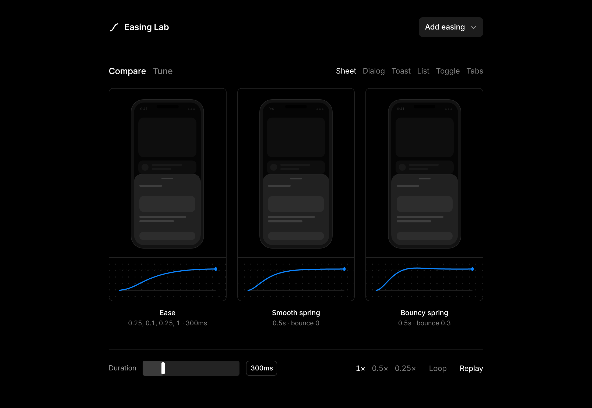

# Easing Lab

Run the same interface animation through different easing curves, side by side, and watch
where they actually differ. Built because a curve on a graph tells you very little until you
see it move a real bottom sheet.



## What it does

- **Compare** up to six curves at once on one of six interactions: sheet, dialog,
  toast, staggered list, toggle and tabs. Every card plays off the same clock, so the
  difference you see is the curve and nothing else.
- **Interrupt** every card halfway and reverse it. A timing curve drops its speed and
  restarts its curve, so its graph turns a sharp corner; a spring carries its speed into the
  new direction and turns smoothly. That difference is the real reason to use springs.
  Press Interrupt again mid-run to send it back.
- **Slow it down** to 0.5x or 0.25x. Most curves look identical at full speed over short
  distances; at a quarter speed they do not.
- **Tune** a curve by dragging the bezier handles or the x1/y1/x2/y2 sliders, or by setting a spring's duration and
  bounce, and copy the result as CSS, Motion, SwiftUI, UIKit, Jetpack Compose or Tailwind.
- 36 curves in the library: the CSS standards, the full power set (sine through circ),
  the back/anticipation curves, Material 3's system curves and seven springs.

## Accessibility

Checked with axe-core (WCAG 2.2 AA and best practice: no violations) and a keyboard and
screen reader walkthrough.

- **Keyboard.** Every control is reachable. Interaction, playback speed and easing family are
  single radio groups (one Tab stop, arrow keys to choose); the views and code formats are
  tabs with arrow-key navigation. Space replays from anywhere that doesn't already use it.
  The Add easing dropdown takes focus when it opens and gives it back on Escape.
- **Screen readers.** The phone mocks are hidden; each card is named by its curve and
  described by what the curve does. Adding, removing, copying, interrupting and resetting
  are announced. Card buttons name their curve ("Remove Ease out").
- **Reduced motion.** Nothing plays or loops by itself. Replay steps through six frames
  instead of moving, so every state is still shown; a visible switch turns smooth playback
  back on for people who want it.
- **Targets and contrast.** Every control is at least 24 by 24px, with larger touch areas on
  touch screens. `prefers-contrast: more` brightens secondary text and underlines the current
  choice; Windows high contrast keeps the phone mocks readable and restores native sliders.

## Using Tune

Type exact values into any box, or type four numbers or a CSS keyword into **Curve**. Paste
a cubic-bezier anywhere on the Tune view to load it: a whole CSS line such as
`transition: transform 300ms cubic-bezier(0.17, 0.89, 0.32, 1.1)` works, as does Compose's
`CubicBezierEasing(...)`. Numbers that match a curve in the library open that curve.

## Running it

```sh
npm run dev      # builds, then serves on http://localhost:4173
```

There is no bundler and no dependencies. `npm run build` regenerates the two HTML entry
points from `src/body.html`; everything else is plain ES modules the browser loads directly.

## Deploying

The repository root is the site root: `index.html`, `styles.css` and `js/` are served as they
are. `vercel.json` pins the settings, so importing the repo on Vercel needs no changes in the
import screen:

| Setting | Value |
| --- | --- |
| Root Directory | `./` (leave it alone) |
| Framework Preset | Other |
| Build Command | `node build.js` |
| Output Directory | `.` |
| Install Command | none needed, there are no dependencies |

`node build.js` only regenerates the two HTML entry points from `src/body.html`. They are
committed, so the site also deploys correctly with the build step disabled.

Vercel builds the repository's default branch as production. From the CLI:

```sh
npx vercel        # preview deployment
npx vercel --prod # production
```

## How the curves are computed

Timing curves use the same cubic-bezier solver browsers use: Newton-Raphson with a bisection
fallback.

Springs are parameterised by **duration and bounce** rather than stiffness, damping and mass,
matching SwiftUI's `Spring(duration:bounce:)` and Motion's `spring({ duration, bounce })`.
Internally that maps to a damping ratio (`1 - bounce` when bounce is positive,
`1 / (1 + bounce)` when negative) and a natural frequency of `2π / duration`, then solves the
underdamped, critically damped or overdamped case as needed. Because a spring keeps moving
after its nominal duration, the settle time is found numerically and shown on each card.

Interruptions follow what each kind of animation really does. A reversed CSS transition is
shortened by how far it had travelled (the spec's reversing shortening factor) and replays its
curve from the start. A spring is re-solved from its current position and velocity towards the
new target, which is why it never stutters.

CSS output for springs is a sampled [`linear()`](https://developer.mozilla.org/en-US/docs/Web/CSS/easing-function#linear_easing_function)
easing, which is how you run a real spring through a CSS transition.

## Layout

```
src/body.html    page markup, the single source for both entry points
styles.css       tokens and all styling
js/easings.js    curve math, the library, code generation
js/motion.js     playback over time, and interruption
js/curve.js      SVG plotting
js/demos.js      the UI blocks inside the phone
js/app.js        state, grid, playback clock, tuning bench
build.js         writes index.html (standalone) and artifact.html (embedded)
serve.js         dependency-free static server
```

`index.html` is the standalone page for any static host. `artifact.html` is the same page
without the document skeleton, for embedding where the host supplies it. Both are generated:
edit `src/body.html`, not the output.
