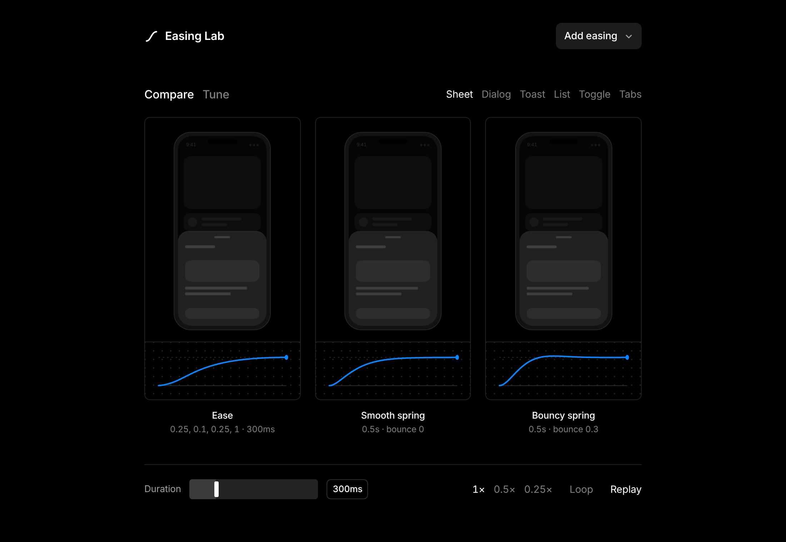

# Easing Lab

Run the same interface animation through different easing curves, side by side, and watch
where they actually differ. Built because a curve on a graph tells you very little until you
see it move a real bottom sheet.



## What it does

- **Compare** up to six curves at once on one of six interactions: bottom sheet, dialog,
  toast, staggered list, toggle and tab switch. Every card plays off the same clock, so the
  difference you see is the curve and nothing else.
- **Slow it down** to 0.5x or 0.25x. Most curves look identical at full speed over short
  distances; at a quarter speed they do not.
- **Tune** a curve by dragging the bezier handles, or by setting a spring's duration and
  bounce, and copy the result as CSS, Motion, SwiftUI or Tailwind.
- 36 curves in the library: the CSS standards, the full power set (sine through circ),
  the back/anticipation curves, Material 3's system curves and seven springs.

## Running it

```sh
npm run dev      # builds, then serves on http://localhost:4173
```

There is no bundler and no dependencies. `npm run build` regenerates the two HTML entry
points from `src/body.html`; everything else is plain ES modules the browser loads directly.

## Deploying

The repository root is the site root: `index.html`, `styles.css` and `js/` are served as they
are. `vercel.json` pins the settings, so importing the repo on Vercel needs no changes in the
import screen:

| Setting | Value |
| --- | --- |
| Root Directory | `./` (leave it alone) |
| Framework Preset | Other |
| Build Command | `node build.js` |
| Output Directory | `.` |
| Install Command | none needed, there are no dependencies |

`node build.js` only regenerates the two HTML entry points from `src/body.html`. They are
committed, so the site also deploys correctly with the build step disabled.

Vercel builds the repository's default branch as production. From the CLI:

```sh
npx vercel        # preview deployment
npx vercel --prod # production
```

## How the curves are computed

Timing curves use the same cubic-bezier solver browsers use: Newton-Raphson with a bisection
fallback.

Springs are parameterised by **duration and bounce** rather than stiffness, damping and mass,
matching SwiftUI's `Spring(duration:bounce:)` and Motion's `spring({ duration, bounce })`.
Internally that maps to a damping ratio (`1 - bounce` when bounce is positive,
`1 / (1 + bounce)` when negative) and a natural frequency of `2π / duration`, then solves the
underdamped, critically damped or overdamped case as needed. Because a spring keeps moving
after its nominal duration, the settle time is found numerically and shown on each card.

CSS output for springs is a sampled [`linear()`](https://developer.mozilla.org/en-US/docs/Web/CSS/easing-function#linear_easing_function)
easing, which is how you run a real spring through a CSS transition.

## Layout

```
src/body.html    page markup, the single source for both entry points
styles.css       tokens and all styling
js/easings.js    curve math, the library, code generation
js/curve.js      SVG plotting
js/demos.js      the UI blocks inside the phone
js/app.js        state, grid, playback clock, tuning bench
build.js         writes index.html (standalone) and artifact.html (embedded)
serve.js         dependency-free static server
```

`index.html` is the standalone page for any static host. `artifact.html` is the same page
without the document skeleton, for embedding where the host supplies it. Both are generated:
edit `src/body.html`, not the output.
